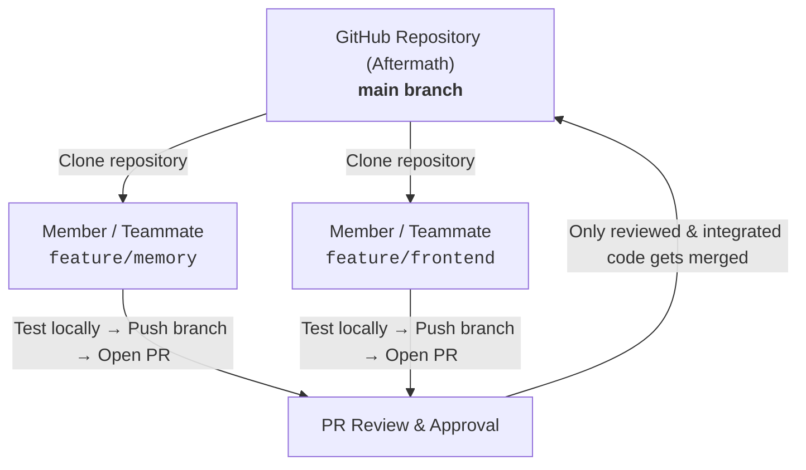

# Contributing to Aftermath

Welcome to **Aftermath**! To keep collaboration smooth, organized, and avoid merge conflicts during development, we follow a simple Git feature-branch workflow.

---

## 📌 Recommended Workflow Overview



---

## 🚀 Step-by-Step Guide for Teammates

### 1. Accept Invitation & Clone the Repository
Once you accept your collaborator invite on GitHub:

```bash
git clone https://github.com/ItzAditya43/Aftermath.git
cd Aftermath
```

---

### 2. Create Your Feature Branch
**Never push directly to `main`.** Always create an isolated branch for the feature or module you are working on:

```bash
# Make sure your local main is up to date
git checkout main
git pull origin main

# Create and switch to your feature branch
git checkout -b feature/<feature-name>
```

*Examples:*
- `feature/memory`
- `feature/frontend`
- `feature/agent-core`
- `fix/api-timeout`

---

### 3. Code and Test Locally
- Work on your changes in your branch.
- Test your code locally before committing to make sure nothing is broken.

---

### 4. Commit and Push Your Branch
Write concise, descriptive commit messages following conventional commits (e.g., `feat: ...`, `fix: ...`, `docs: ...`):

```bash
git add .
git commit -m "feat: implement <feature-description>"
git push -u origin feature/<feature-name>
```

---

### 5. Open a Pull Request (PR)
1. Go to the [Aftermath Repository](https://github.com/ItzAditya43/Aftermath).
2. You will see a banner prompt to create a Pull Request from your pushed branch.
3. Open a PR with target:
   $$\text{feature/your-branch} \longrightarrow \text{main}$$
4. Provide a clear summary of:
   - What was added / changed.
   - How to test it.
5. Request a review from teammates / repository owner.

---

### 6. Review and Merge
- Reviewers will verify the code and test locally if needed.
- Once approved, the PR is merged into `main`.
- After merging, delete the remote and local feature branch:
  ```bash
  git checkout main
  git pull origin main
  git branch -d feature/<feature-name>
  ```

---

## 💡 Best Practices
- **Sync Frequently:** Run `git pull origin main` regularly into your local branch to stay up to date and resolve conflicts early.
- **Atomic Commits:** Keep commits focused on specific tasks or components.
- **Communication:** Ping the team if your changes introduce major schema/dependency updates.

